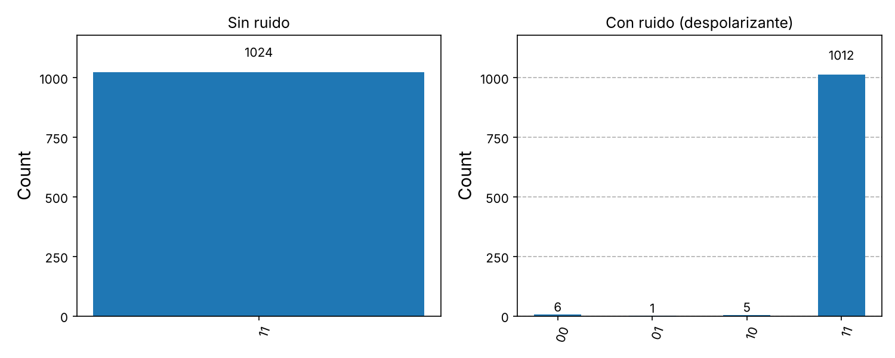

# Post-Contenido 1 — Circuitos cuánticos con Qiskit y criptografía post-cuántica
Arquitectura de Computadores — Unidad 12

**Estudiante:** Juan Diego Rojas Rey — código 1152512
**Programa:** Ingeniería de Sistemas, UFPS

El repositorio tiene dos partes. La Parte 1 son cuatro scripts de Qiskit que se ejecutan sobre el simulador `AerSimulator` (estado de Bell, Deutsch-Jozsa, Grover de 2 qubits y Grover con ruido) más un experimento extra de barrido de ruido. La Parte 2 es el análisis de criptografía post-cuántica en [`docs/analisis-pqc.md`](docs/analisis-pqc.md).

## Estructura

```
src/bell_state.py        Estado de Bell
src/deutsch_jozsa.py     Deutsch-Jozsa, n = 2
src/grover.py            Grover, 2 qubits, los 4 objetivos
src/grover_noise.py      Grover con NoiseModel despolarizante
src/ruido_barrido.py     Extra: barrido de la tasa de error y de la profundidad
docs/analisis-pqc.md     Parte 2
capturas/                Histogramas y salidas de terminal de cada checkpoint
requirements.txt
```

## Cómo reproducir

```bash
pip install -r requirements.txt
python src/bell_state.py
python src/deutsch_jozsa.py
python src/grover.py
python src/grover_noise.py
python src/ruido_barrido.py      # opcional, tarda unos segundos
```

Los scripts se corrieron con Python 3.13, `qiskit` 2.6.2 y `qiskit-aer` 0.18.4. La API usada (`QuantumCircuit`, `AerSimulator`, `NoiseModel`) es la misma de Qiskit 1.x. Los histogramas se guardan en `capturas/`. Como el simulador muestrea al azar, los conteos cambian un poco entre corridas (por ejemplo 508/516 o 510/514 en Bell); los valores de abajo son los de las capturas incluidas.

## Parte 1

### 1. Estado de Bell

```
     ┌───┐     ┌─┐
q_0: ┤ H ├──■──┤M├───
     └───┘┌─┴─┐└╥┘┌─┐
q_1: ─────┤ X ├─╫─┤M├
          └───┘ ║ └╥┘
c: 2/═══════════╩══╩═
                0  1
```

La Hadamard deja al qubit 0 en (|0⟩+|1⟩)/√2 y el CNOT copia esa superposición sobre el qubit 1 sin separar los dos estados, de modo que el estado final es (|00⟩+|11⟩)/√2. No se puede escribir como producto de un estado del qubit 0 por un estado del qubit 1, y eso es el entrelazamiento.

| Estado | Conteos (1024 shots) | Porcentaje |
|---|---|---|
| \|00⟩ | 510 | 49,8 % |
| \|11⟩ | 514 | 50,2 % |
| \|01⟩, \|10⟩ | 0 | 0 % |

Interpretación: cada resultado individual es aleatorio (50/50), pero los dos qubits siempre coinciden. Esa correlación perfecta es la huella del entrelazamiento y el `assert` del script falla si aparece algún |01⟩ o |10⟩. Captura: `capturas/bell_histogram.png` y `capturas/cp1_bell_terminal.png`.

### 2. Deutsch-Jozsa (n = 2)

```
     ┌───┐      ░            ░ ┌───┐┌─┐
q_0: ┤ H ├──────░───■────────░─┤ H ├┤M├───
     ├───┤      ░   │        ░ ├───┤└╥┘┌─┐
q_1: ┤ H ├──────░───┼────■───░─┤ H ├─╫─┤M├
     ├───┤┌───┐ ░ ┌─┴─┐┌─┴─┐ ░ └───┘ ║ └╥┘
q_2: ┤ X ├┤ H ├─░─┤ X ├┤ X ├─░───────╫──╫─
     └───┘└───┘ ░ └───┘└───┘ ░       ║  ║
c: 2/════════════════════════════════╩══╩═
                                     0  1
```

El qubit 2 es el ancilla, preparado en |−⟩ con X y H. Entre las barreras está el oráculo; en la figura aparece el balanceado (dos CNOT hacia el ancilla), y el constante deja esa zona vacía.

| Oráculo | Resultado medido | Conclusión |
|---|---|---|
| Constante f(x) = 0 | `{'00': 1024}` | constante |
| Balanceado f(x) = x0 ⊕ x1 | `{'11': 1024}` | balanceada (nunca \|00⟩) |

Por qué basta una evaluación del oráculo: el ancilla en |−⟩ convierte el oráculo en una fase (−1)^f(x) sobre cada entrada (*phase kickback*), y como las entradas están en superposición uniforme, esa única llamada marca a todas a la vez. La segunda capa de Hadamard hace interferir esas fases. Si f es constante la fase es global y las amplitudes vuelven a |00⟩; si es balanceada, la amplitud de |00⟩ se cancela exactamente. Por eso el resultado es determinista y no probabilístico. Un algoritmo clásico determinista necesita, en el peor caso, 2^(n−1) + 1 = 3 evaluaciones para n = 2 (si las dos primeras dan el mismo valor todavía no puede asegurar que sea constante).

Captura: `capturas/cp2_deutsch_jozsa_terminal.png`.

### 3. Grover con 2 qubits

```
     ┌───┐   ┌───┐┌───┐   ┌───┐┌───┐┌─┐
q_0: ┤ H ├─■─┤ H ├┤ X ├─■─┤ X ├┤ H ├┤M├───      (objetivo |11>)
     ├───┤ │ ├───┤├───┤ │ ├───┤├───┤└╥┘┌─┐
q_1: ┤ H ├─■─┤ H ├┤ X ├─■─┤ X ├┤ H ├─╫─┤M├
     └───┘   └───┘└───┘   └───┘└───┘ ║ └╥┘
```

Primero la superposición uniforme, luego el oráculo (un CZ que cambia la fase de |11⟩; para los otros objetivos se rodea con X sobre los qubits que valen 0) y por último el difusor H·X·CZ·X·H. Se probaron los cuatro objetivos con 1024 shots:

| Objetivo | Estado más probable | Probabilidad | Resultado |
|---|---|---|---|
| \|00⟩ | \|00⟩ | 100,0 % | correcto |
| \|01⟩ | \|01⟩ | 100,0 % | correcto |
| \|10⟩ | \|10⟩ | 100,0 % | correcto |
| \|11⟩ | \|11⟩ | 100,0 % | correcto |

Por qué basta una iteración con n = 2: el estado inicial forma un ángulo θ con sen θ = 1/√4 = 1/2, es decir θ = 30°. Cada iteración de Grover gira el vector 2θ hacia el objetivo, así que después de k iteraciones la probabilidad es sen²((2k+1)θ). Con k = 1 el ángulo es 3θ = 90° y la probabilidad es sen²(90°) = 1. Una segunda iteración pasaría de largo (5θ = 150°, probabilidad 25 %). Para n = 2 el simulador ideal da exactamente 100 %, no solo "más del 90 %".

Capturas: `capturas/grover_00.png`, `grover_01.png`, `grover_10.png`, `grover_11.png` y `cp3_grover_terminal.png`. Nota: Qiskit ordena los bits en little-endian (el qubit 0 es el bit de la derecha), y el oráculo del script tiene eso en cuenta.

### 4. Grover bajo ruido despolarizante

Se reutiliza el circuito del paso 3 (objetivo |11⟩) y se simula dos veces: sin ruido y con un `NoiseModel` que aplica error despolarizante de 0,1 % a cada puerta de 1 qubit (`h`, `x`) y de 1 % a cada `cz`.

| Simulación | P(\|11⟩) | Conteos (1024 shots) |
|---|---|---|
| Sin ruido | 100,0 % | `{'11': 1024}` |
| Con ruido (p1q = 0,1 %, p2q = 1 %) | 98,8 % | `{'00': 6, '01': 1, '10': 5, '11': 1012}` |
| Degradación | 1,2 puntos porcentuales | |



**Una diferencia con lo que anticipa la guía.** El enunciado habla de una probabilidad bajo ruido de entre 85 % y 92 %. Con las tasas que se pide configurar, esa cifra no sale: el circuito tiene solo 2 puertas CZ y unas 12 puertas de 1 qubit, así que el error acumulado esperado es de unos 2 % y la degradación medida (1–2 puntos según la corrida, 98–99 %) es coherente con eso. No se modificó el experimento para forzar un número; en cambio se agregó `src/ruido_barrido.py`, que muestra qué hace falta para llegar a una degradación como la que menciona la guía.

**Barrido extra** (8192 shots por punto, p1q = 0,1 %; captura `capturas/ruido_barrido.png`):

| Error de 2 qubits | P(\|11⟩) | | CZ en el circuito (p2q = 1 %) | P(\|11⟩) |
|---|---|---|---|---|
| 0,0 % | 99,5 % | | 2 | 97,9 % |
| 0,5 % | 98,6 % | | 6 | 95,3 % |
| 1,0 % | 97,9 % | | 12 | 91,0 % |
| 2,0 % | 96,4 % | | 22 | 84,7 % |
| 5,0 % | 92,5 % | | 42 | 74,3 % |
| 10,0 % | 85,2 % | | 82 | 57,5 % |
| 15,0 % | 79,2 % | | 162 | 40,2 % |

En el barrido de la derecha se alargó el circuito con pares de CZ (dos CZ seguidos son la identidad, así que sin ruido no cambian el resultado, pero cada uno suma una puerta ruidosa). Con 162 CZ y la misma tasa de 1 %, la probabilidad de éxito baja a 40 %, ya cerca del 25 % que daría adivinar al azar entre 4 estados.

### Decisión técnica 1: ¿el resultado de Grover con ruido sigue siendo útil o requiere corrección de errores?

Para este circuito el resultado sigue siendo útil y no hace falta corrección de errores. Con el ruido configurado, |11⟩ salió 1012 veces de 1024 (98,8 %) y cada uno de los otros tres estados apareció entre 1 y 6 veces. Con 1024 shots el error estadístico de esa proporción es de unos 0,3 puntos, así que la diferencia con el segundo estado más probable es enorme y la respuesta se identifica con confianza. El problema aparece al escalar. El error se acumula de forma multiplicativa: si cada puerta de 2 qubits falla con probabilidad 1 %, un circuito con G de esas puertas conserva alrededor de 0,99^G de fidelidad. El barrido lo confirma, porque con 162 CZ el éxito cae a 40 %. Grover con 20 qubits necesita del orden de (π/4)·√(2²⁰) ≈ 800 iteraciones, y cada una incluye una puerta multicontrolada que se descompone en decenas de CZ; con 0,99 elevado a decenas de miles de puertas la señal desaparece y el histograma sería indistinguible del ruido. El umbral de tolerancia a fallos, citado cerca del 1 % para el código de superficie, es una condición necesaria pero no suficiente: en la práctica hace falta una tasa física bastante menor y cientos o miles de qubits físicos por qubit lógico. Conclusión: circuitos pequeños y poco profundos como los de este laboratorio se pueden correr directamente sobre qubits físicos con mitigación a lo sumo; algoritmos con utilidad real (Shor sobre claves de miles de bits, simulación de moléculas) requieren qubits lógicos con corrección de errores.

### Decisión técnica 2: ¿qué tan representativo es el modelo despolarizante frente al hardware real?

El modelo despolarizante es una aproximación pedagógica y no un modelo fiel de un procesador. Trata todos los errores por igual (X, Y o Z con la misma probabilidad), en todos los qubits y en todas las puertas del mismo tipo, y no depende del tiempo. En un procesador superconductor real cada qubit tiene su propio T1 (relajación de energía, |1⟩ → |0⟩) y su propio T2 (pérdida de fase), distintos entre sí, y el error depende de cuánto tiempo pasa el qubit ocioso o en una puerta. Una puerta de 2 qubits dura varias veces más que una de 1 qubit y por eso acumula más decoherencia; además cada par de qubits acoplados tiene su propia tasa, y la medición agrega un error de lectura (*readout*) que este modelo no incluye. Todo eso lo pierde el modelo simple, y por eso puede subestimar o sobreestimar el error según el circuito. Aun así, para este laboratorio es razonable usarlo: el objetivo es mostrar de forma controlada y reproducible que el ruido degrada el resultado, y `NoiseModel.from_backend()` ataría el experimento a un backend de IBM concreto, a una cuenta y a datos de calibración que cambian a diario. Si el objetivo fuera predecir cómo se comportaría este circuito en un procesador específico antes de gastar tiempo de hardware, habría que usar `NoiseModel.from_backend()` con la calibración más reciente de ese equipo, porque solo ese modelo incorpora T1/T2, errores por par de qubits y lectura.

## Parte 2

El análisis está en [`docs/analisis-pqc.md`](docs/analisis-pqc.md): inventario de algoritmos vulnerables, estándares NIST FIPS 203/204/205, plan de migración para los tres perfiles, tabla de tamaños de claves y firmas con su impacto en un handshake TLS 1.3 híbrido, las decisiones técnicas 3 y 4, conclusiones y referencias en APA.

## Capturas

| Archivo | Contenido |
|---|---|
| `capturas/bell_histogram.png` | Histograma del estado de Bell |
| `capturas/cp1_bell_terminal.png` | Salida de terminal y circuito de Bell |
| `capturas/cp2_deutsch_jozsa_terminal.png` | Salida de Deutsch-Jozsa |
| `capturas/grover_00.png` … `grover_11.png` | Histogramas de Grover para los 4 objetivos |
| `capturas/cp3_grover_terminal.png` | Salida de terminal de Grover |
| `capturas/grover_noise_comparison.png` | Comparación con y sin ruido |
| `capturas/cp4_grover_noise_terminal.png` | Salida de terminal del experimento con ruido |
| `capturas/ruido_barrido.png`, `cp5_ruido_barrido_terminal.png` | Barrido extra de la tasa de error y la profundidad |
